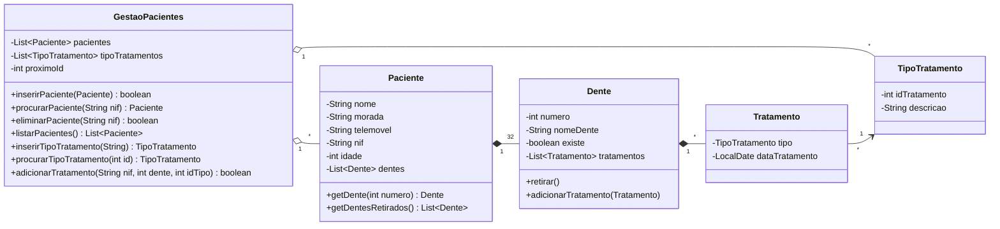

<div align="center">

# 🦷 Gestão de Pacientes de um Dentista

**Aplicação de consola em Java para gerir pacientes, a sua dentição e o histórico de tratamentos de um consultório dentário.**


*Projeto final da unidade curricular de **Linguagens de Programação** — CTeSP em Redes e Sistemas Informáticos, Escola Superior de Ciência e Tecnologia (2025/2026)*

</div>

---

## 📋 Índice

- [Sobre o projeto](#-sobre-o-projeto)
- [Funcionalidades](#-funcionalidades)
- [Modelo de dados](#-modelo-de-dados)
- [Estrutura do projeto](#-estrutura-do-projeto)
- [Como executar](#-como-executar)
- [Exemplo de utilização](#-exemplo-de-utilização)
- [Relatório](#-relatório)
- [Autor](#-autor)

---

## 📖 Sobre o projeto

Este programa permite a um dentista registar os seus pacientes e acompanhar os tratamentos feitos a cada dente.

Cada **paciente** tem os seus dados pessoais (nome, morada, telemóvel, idade e NIF) e uma **dentição completa de 32 dentes**, criada automaticamente no registo. Cada **dente** tem a sua designação anatómica, um estado (presente ou retirado) e um histórico de **tratamentos**, cada um associado a um **tipo de tratamento** e à data em que foi feito.

O projeto foi desenvolvido em **Java** segundo os princípios da **programação orientada a objetos**, com o código separado em três camadas: modelo, serviço e visualização.

---

## ✨ Funcionalidades

| Opção | Funcionalidade | Descrição |
|:---:|---|---|
| `1` | **Inserir paciente** | Regista um novo paciente com validação dos campos obrigatórios. O NIF não pode estar repetido. |
| `2` | **Listar pacientes** | Mostra todos os pacientes registados e os seus dados. |
| `3` | **Alterar paciente** | Altera o nome, a morada, o telemóvel, o NIF ou a idade de um paciente. |
| `4` | **Eliminar paciente** | Remove um paciente através do NIF. |
| `5` | **Inserir tipo de tratamento** | Cria um novo tipo de tratamento, com ID atribuído automaticamente. |
| `6` | **Listar tipos de tratamento** | Mostra todos os tipos de tratamento disponíveis. |
| `7` | **Gerir dente** | Retira um dente ou adiciona-lhe um tratamento (com a data do dia). |
| `8` | **Ver tratamentos efetuados** | Mostra os dentes retirados e os tratamentos feitos a um paciente. |
| `0` | **Sair** | Termina a aplicação. |

### 🩺 Tipos de tratamento predefinidos

Ao iniciar, a aplicação já inclui estes tipos de tratamento:

1. Destartarização
2. Obturação
3. Extração
4. Tratamento de canal
5. Branqueamento

> [!NOTE]
> Um dente retirado deixa de poder receber tratamentos.

---

## 🧩 Modelo de dados



---

## 📁 Estrutura do projeto

```
Projeto Final/
├── Relatorio Final Dentista-2.pdf      # Relatório do projeto
└── main/
    └── src/
        ├── Main.java                   # Ponto de entrada da aplicação
        ├── modelo/                     # Classes de domínio
        │   ├── Paciente.java
        │   ├── Dente.java
        │   ├── Tratamento.java
        │   └── TipoTratamento.java
        ├── servico/                    # Lógica de negócio
        │   └── GestaoPacientes.java
        └── visualizacao/               # Interface de consola
            └── Menu.java
```

| Camada | Responsabilidade |
|---|---|
| **`modelo`** | Representa as entidades do domínio: pacientes, dentes, tratamentos e tipos de tratamento. |
| **`servico`** | Guarda as listas e implementa as operações de inserir, procurar, eliminar e associar tratamentos. |
| **`visualizacao`** | Mostra o menu, lê e valida o que o utilizador escreve e apresenta os resultados. |

---

## 🚀 Como executar

### Pré-requisitos

- **Java JDK 17** ou superior

### Pela linha de comandos

```bash
# 1. Clonar o repositório
git clone <url-do-repositorio>
cd "<pasta-do-repositorio>/Projeto Final/main"

# 2. Compilar
javac -d out $(find src -name "*.java")

# 3. Executar
java -cp out Main
```

### Pelo IntelliJ IDEA

1. Abrir a pasta `Projeto Final/main` como projeto.
2. Configurar o SDK do projeto (JDK 17 ou superior).
3. Executar a classe `Main`.

---

## 💻 Exemplo de utilização

```text
=== Gestao de Pacientes ===
1 - Inserir paciente
2 - Listar pacientes
3 - Alterar paciente
4 - Eliminar paciente
5 - Inserir tipo de tratamento
6 - Listar tipos de tratamento
7 - Gerir dente (retirar / adicionar tratamento)
8 - Ver tratamentos efetuados de um paciente
0 - Sair
7
NIF do paciente: 123456789
Numero do dente (1-32): 14
O que pretende fazer ao dente 1º molar superior esquerdo?
1 - Retirar dente
2 - Adicionar tratamento
2
Tipos de tratamento:
1 - Destartarização
2 - Obturação
3 - Extração
4 - Tratamento de canal
5 - Branqueamento
Id do tipo de tratamento: 2
Tratamento adicionado.
```

```text
8
NIF do paciente: 123456789
Tratamentos efetuados a Ana Silva:
14 - 1º molar superior esquerdo [Existe]
      tratamento: Obturação (2026-10-26)
```

### 🦷 Numeração dos dentes

Os 32 dentes são numerados de **1 a 32**, por quadrantes:

| Números | Quadrante |
|:---:|---|
| 1 – 8 | Superior direito |
| 9 – 16 | Superior esquerdo |
| 17 – 24 | Inferior esquerdo |
| 25 – 32 | Inferior direito |

Em cada quadrante, a ordem é: incisivo central, incisivo lateral, canino, 1º e 2º pré-molar, 1º, 2º e 3º molar.

> [!IMPORTANT]
> Os dados ficam guardados apenas em memória e perdem-se quando a aplicação fecha.

---

## 📄 Relatório

O relatório completo, com a estrutura de dados, os algoritmos e o manual do utilizador, está em
[`Projeto Final/Relatorio Final Dentista-2.pdf`](Projeto%20Final/Relatorio%20Final%20Dentista-2.pdf).

---

## 👤 Autor

**Nuno Cunha**
CTeSP em Redes e Sistemas Informáticos — Escola Superior de Ciência e Tecnologia

Docente: Prof. Jorge Vieira

<div align="center">

<sub>Desenvolvido no âmbito da UC de Linguagens de Programação · 2025/2026</sub>

</div>
